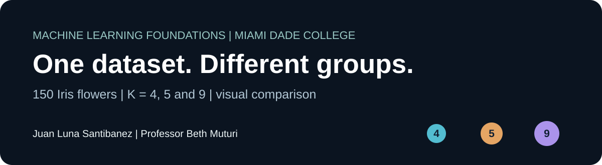
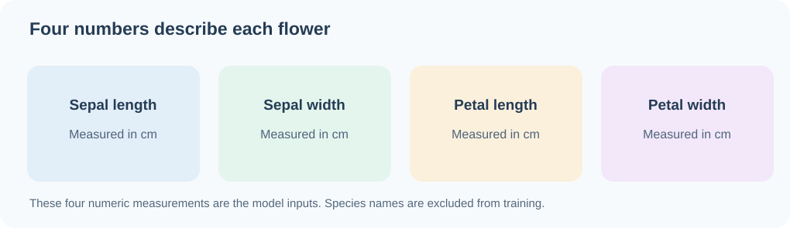
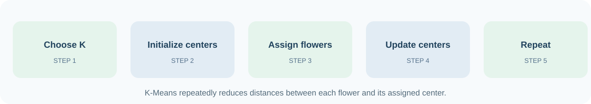
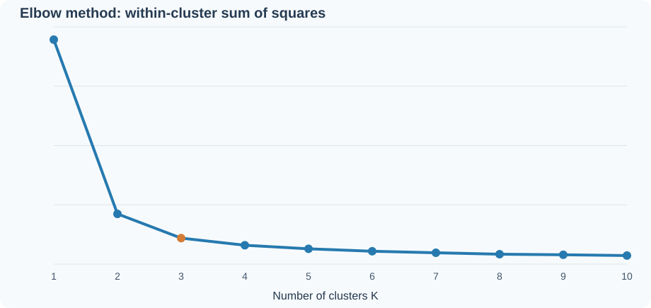
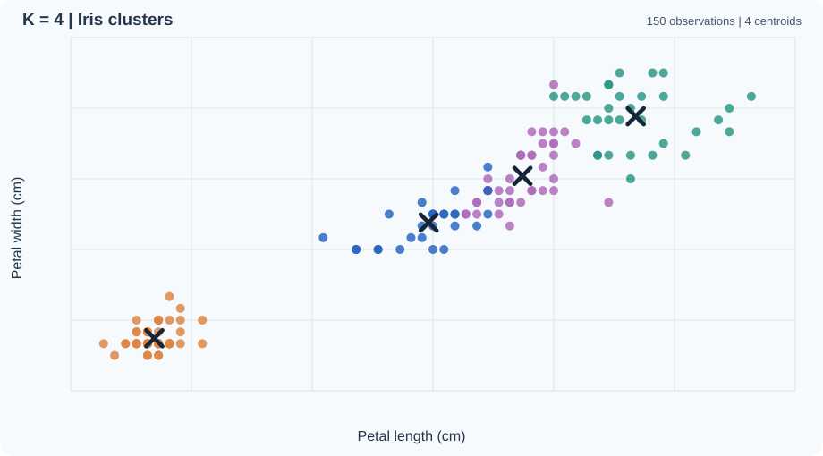
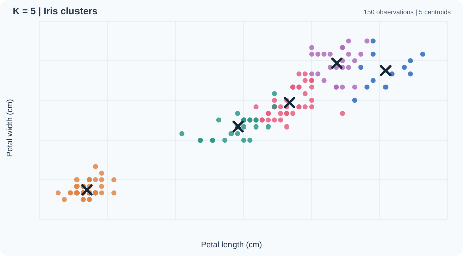
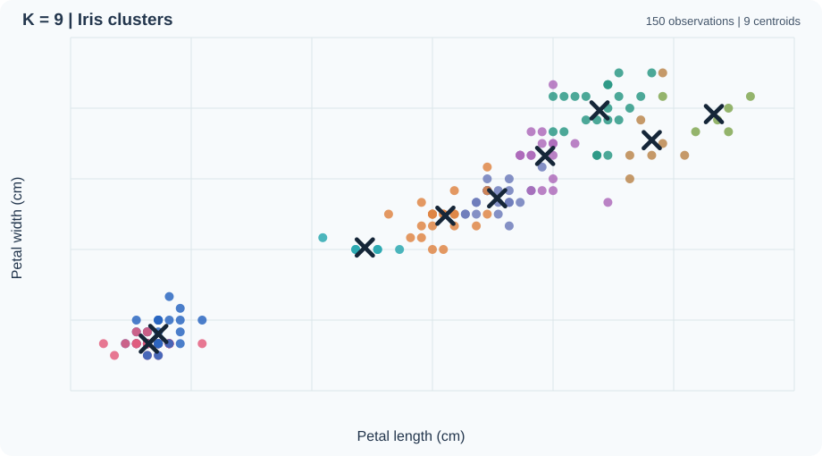

<div align="center">

# K-Means Clustering and Iris Visualization

### CAI2100C-2267-6908 | Machine Learning Foundations

**Juan Luna Santibanez**  
**Miami Dade College** | **Professor Beth Muturi**


**150 flowers. Four measurements. Three assigned experiments.**

*What changes when K-Means creates 4, 5, or 9 groups from the same dataset?*

[**Google Colab**](https://colab.research.google.com/github/SupaHumano/CAI2100C-KMeans-Visualization/blob/main/notebooks/KMeans_Iris_Juan_Luna_Santibanez.ipynb) · [**Notebook on GitHub**](notebooks/KMeans_Iris_Juan_Luna_Santibanez.ipynb) · [**Kaggle Setup**](#kaggle-notebooks) · [**Live Demo**](https://supahumano.github.io/CAI2100C-KMeans-Visualization/)

</div>



---

[Overview](#overview) · [Assignment](#assignment-objectives) · [Process](#how-k-means-works) · [Results](#visual-results) · [Methodology](#methodology-and-reproducibility) · [Run](#run-the-notebook) · [Structure](#repository-structure) · [References](#references)

## Overview

K-Means is an **unsupervised learning** algorithm that groups observations according to distance. It uses the measurements provided to locate cluster centers called **centroids**. In this project, the algorithm uses four numeric characteristics from 150 Iris flowers.



The species labels are present for background context but **are not supplied to K-Means during training**. A mathematical cluster is not automatically a biological species.

## Assignment Objectives

The class demonstration begins with K = 3. Professor Beth Muturi's **Assignment 7: K-Means Visualization** asks us to repeat the experiment for the following numbers of clusters:

| K | Required observation | Chart |
|:---:|---|:---:|
| **4** | Four fitted clusters and four centroids | [View chart](assets/clusters-k4.svg) |
| **5** | Five fitted clusters and five centroids | [View chart](assets/clusters-k5.svg) |
| **9** | Nine fitted clusters and nine centroids | [View chart](assets/clusters-k9.svg) |

The K = 3 visualization serves as a **classroom reference only**. It does not replace any of the three required experiments.

## How K-Means Works



1. **Choose K.** Select how many clusters the algorithm should find.
2. **Place the centers.** Initialize K centroids using `k-means++`.
3. **Assign the flowers.** Each flower joins the group with the closest center in four-dimensional feature space.
4. **Update the centroids.** Each center moves to the average position of its assigned flowers.
5. **Repeat.** Continue until the model reaches its convergence rule.

**Inertia** is the sum of squared distances from each flower to its assigned centroid. It is useful for comparing how tightly the same observations can be represented with different values of K.

## Visual Results

### The elbow method



The elbow suggests a useful reference value near **K = 3**, but no elbow plot alone can prove the correct number of biological species.

### K = 4 and K = 5

| K = 4 | K = 5 |
|:---:|:---:|
|  |  |

### K = 9



**Reading the figures:** colored dots show observations assigned to clusters. Crosses show the fitted centroids. The models use **all four flower measurements**, while the plots display **petal length and petal width** so they can be understood on a two-dimensional screen. Colors are cluster IDs, not species names.

### Quantitative comparison

| Cluster count | Inertia |
|:---:|---:|
| 3, classroom reference | 78.851 |
| **4** | **57.228** |
| **5** | **46.446** |
| **9** | **28.333** |

When K increases, the same observations can be divided into more specific groups and inertia generally falls. **Lower inertia does not mean that nine flower species exist.** The selection of K must also consider the purpose and interpretability of the result.

## Live Interactive Lab

The [interactive lab](https://supahumano.github.io/CAI2100C-KMeans-Visualization/) allows a visitor to switch between K = 3, 4, 5, and 9; examine the actual observations and cluster centers; and explore two pairs of flower measurements.

The browser shows **precomputed, reproducible scikit-learn results**. It does not retrain the model in JavaScript. The Python notebook contains the computational experiment.

## Methodology and Reproducibility

The analysis follows the instruction to visualize K = 4, 5, and 9 without changing the dataset or treating known labels as training inputs.

- **Dataset:** 150 Iris measurements from the MDC course materials, with four numeric features and no missing values.
- **Libraries:** Pandas, NumPy, Matplotlib, Seaborn, scikit-learn and Jupyter.
- **Model:** `KMeans(init="k-means++", n_init=10, max_iter=300, random_state=0)`.
- **Input features:** sepal length, sepal width, petal length and petal width.
- **Visualizations:** elbow plot and cluster scatter plots with centroid markers.
- **Validation:** one assignment per observation, exactly K fitted centers, consistent data across experiments, and reproducible inertia.
- **Scope:** the public notebook presents the academic methods and required experiments. Instructor-authored slides and notebook cells are not republished.

Read the [methodology](docs/METHODOLOGY.md) or use the [presentation guide](docs/PRESENTATION_GUIDE.md) to explain the experiment step by step.

## Run the Notebook

### Google Colab

[**Open in Google Colab**](https://colab.research.google.com/github/SupaHumano/CAI2100C-KMeans-Visualization/blob/main/notebooks/KMeans_Iris_Juan_Luna_Santibanez.ipynb). Run all cells. The notebook includes a fallback to fetch the repository's CSV if the file is not already available in the working directory.

### Kaggle Notebooks

Open [Kaggle Code](https://www.kaggle.com/code), create a notebook, and import [this notebook](notebooks/KMeans_Iris_Juan_Luna_Santibanez.ipynb). Add [IRIS.csv](data/IRIS.csv) to the notebook's input datasets before running it. The program can locate the input in Kaggle's `/kaggle/input` directory. A published Kaggle notebook URL is **not yet available**.

### Local Jupyter

```bash
git clone https://github.com/SupaHumano/CAI2100C-KMeans-Visualization.git
cd CAI2100C-KMeans-Visualization
python -m pip install -r requirements.txt
jupyter notebook notebooks/KMeans_Iris_Juan_Luna_Santibanez.ipynb
```

## Repository Structure

```text
CAI2100C-KMeans-Visualization/
├── README.md
├── index.html
├── data/
│   ├── IRIS.csv
│   └── results.js
├── notebooks/
│   └── KMeans_Iris_Juan_Luna_Santibanez.ipynb
├── assets/
│   ├── hero.svg
│   ├── iris-features.svg
│   ├── process.svg
│   ├── elbow.svg
│   ├── clusters-k3.svg
│   ├── clusters-k4.svg
│   ├── clusters-k5.svg
│   └── clusters-k9.svg
├── docs/
│   ├── METHODOLOGY.md
│   └── PRESENTATION_GUIDE.md
├── requirements.txt
└── .gitignore
```

## References

- Miami Dade College, CAI2100C Machine Learning Foundations. Assignment 7: K-Means Visualization. Instructor: Professor Beth Muturi, October 2026.
- [scikit-learn, KMeans](https://scikit-learn.org/stable/modules/generated/sklearn.cluster.KMeans.html).
- [scikit-learn, Clustering](https://scikit-learn.org/stable/modules/clustering.html).
- [UCI Machine Learning Repository, Iris](https://archive.ics.uci.edu/dataset/53/iris).

---

<div align="center">

**Juan Luna Santibanez**  
Miami Dade College | Machine Learning Foundations

*Measure. Cluster. Visualize. Explain.*

</div>
